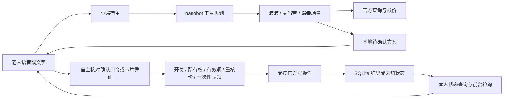
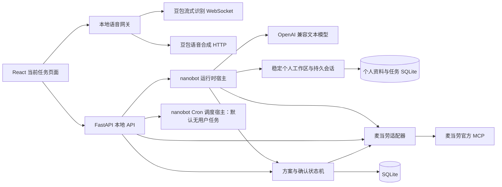

# 架构说明

## 三场景统一执行入口

`app/{didi,mcd,luckin}_scenario.py` 分别管理真实候选和业务规则，`app/actions.py` 管理所有权、SQLite 操作记录、报价比较、确认口令、开关和不可重复执行状态。`prepare()` 仅创建本地方案；模型没有 `confirm()` 或原始写入工具。HTTP 卡片确认和聊天中准确的口头确认由宿主处理，重新核价后才调用适配器 `execute()`。模型上下文剥除确认凭证、原始响应、报价 trace；这些字段不作为对话指令。

方案状态包括 awaiting_confirmation、needs_review、rechecking、submitting、created、cancellation_requested、cancelled、expired、superseded、unknown。确认前读取失败只使方案失效；发送写请求后异常保持 unknown，不能自动重试。新会话不会恢复执行中订单；启动时把 submitting 转为 unknown。真实取消仅在平台明确支持且取消费可核实后提案，不能将请求返回误报成最终取消成功。

前端 `ActionCard` 显示具体商品／规格／接送点、金额和确认口令。仅当前有效方案能确认；新问题或候选变化使旧方案失效。当前最新操作在页面打开时每 30 秒查询一次，状态变化和车牌可通过已有 TTS 播报，不播放恢复历史中的旧状态。页面关闭、Mac 休眠后的推送与后台主动通知仍未实现。

新增北京三服务范围：`app/life_services.py` 以官方 MCP SDK 分别接入瑞幸 Bearer Token 与滴滴 MCP Key，动态发现账号工具、按实际 schema 验证请求、只放行查询白名单。`app/service_skills.py` 将门店、饮品与起终点候选绑定到 owner 会话，先查询后选择，旧候选在重新查询失败后失效；会话存储同时持久化这些候选，重置／遗忘时清除。瑞幸和滴滴的交易工具即使在远程目录中可见，也不注册、不执行。凭据仅后端读取，传输日志对已加载凭据脱敏。新增配置不能代表真实权限和支付闭环已完成验收。

本阶段整合 Personal Agent 基础运行时，保留麦当劳交易切片作为回归能力。底座与业务扩展分开验收，不能将上游框架的全部功能视为小瑞已实现能力。

## 当前模块

- `frontend/`：门店、商品与套餐选项、真实报价、确认与结果反馈。客户端价格和文字不能成为执行凭证。
- `app/main.py`：HTTP 路由、浏览器会话、本地访问边界与静态网页服务。
- `app/agent.py`：nanobot 运行时宿主、会话与事件桥接、候选校验与本地方案生成；不暴露订单执行工具。
- `app/foundation_store.py`：稳定个人资料、展示与候选状态、通用任务记录及中断标记。
- `app/skills.py`：显式受控工具与 Skill 目录，能力与实际业务执行分层。
- `app/foundation_scheduler.py`：nanobot CronService 生命周期；默认无用户任务，无模型与通知交付。
- `app/plans.py`：方案所有权、版本、有效期、一次性确认与持久状态。
- `app/mcd.py`：官方 MCP 连接、实时工具 schema、参数验证、业务结果检查及真实执行。
- `experiments/`：独立集成验证；不等于正式 Agent 产品代码。

运行时目标为一个 Python 服务和 SQLite；开发时有 Vite，生产页面构建后由后端提供。当前不需要独立 Redis、PostgreSQL、向量数据库或媒体服务器。

## 确认与执行

1. 服务端根据真实商品与选项核价，保存规范化请求、金额和取餐方式，生成有版本和有效期的方案。
2. 用户看到具体方案后，用明确确认操作提交该方案的版本与确认凭证；会话必须拥有该方案。
3. 后端检查状态、版本、有效期和执行开关，在数据库中原子认领执行，避免并发双击重复创建订单。
4. 执行前再次核价。金额或取餐方式不再匹配，退回重新审阅，旧确认失效。
5. 调用真实创建订单接口一次。成功后保存订单结果；异常、超时或无法确认的返回保守记为结果未知，不自动重试创建。

创建结果必须显示为「订单已创建／待支付」，不显示「已付款」或「已送达」。旧方案被新方案替换、取消或过期后，不能继续提交。

## 数据与权限

凭证保存在被忽略的本地 `.env`，不返回给浏览器。SQLite 保存本地会话和方案状态；原始账号查询结果与实验数据不提交 GitHub。默认绑定 `127.0.0.1`，浏览器会话 cookie 使用 HttpOnly／SameSite，写接口检查本地来源与主机，不能直接暴露到局域网或公网。

默认 `MCD_ORDER_ENABLED=false`。该开关只是部署执行开关，不能替代每个方案的用户确认。模型提示词、工具说明、MCP 的只读提示或事件 Hook 也不是业务授权。

已验证的 nanobot 默认 Hook 会记录并吞掉部分回调异常，因此后续 Agent 接入仍必须经过此执行层。不能同时开放未经包装的远端下单工具、任意 shell 等绕过路径。

## 失败处理与验证

区分网络连接失败、MCP 错误和业务失败；HTTP 成功不代表可下单。供应商返回夹带说明文字时，只提取明确业务 JSON，不执行文本指令。记录去凭证的诊断信息，用户界面给出可理解的失败提示。

单元测试检查确认、并发、所有权、报价变化与重启后的未知状态，使用测试专用适配器。真实只读 API 已有独立证据；麦当劳真实待支付订单、官方支付入口和待支付状态在受控独立实验中已有验证，网页与真人语音的完整交易仍需现场验收。

## Personal Agent 工作区

固定版本 nanobot 负责执行循环与模型会话，宿主负责权威个人资料、Skill 和任务状态。新聊天更换会话标识，保留本地个人资料；遗忘操作轮换召回代际。语音识别与播报独立于交易执行。自动长期记忆整理、跨领域任务和系统通知仍需后续实现，不以旧聊天内容仍在上下文中证明长期记忆。

### 长期记忆与主动交流的目标架构（规划）

产品方向以 [产品理念与理想态](docs/product-identity.md) 为准。后续在现有宿主上扩展“了解 → 确认 → 记忆 → 主动提议 → 反馈修正”的闭环：

- **记忆输入**：用户明确陈述、相关情境中的简短询问和对推荐的反馈。区分本轮要求、待确认的习惯线索与已确认长期事实；记录来源、时间和适用范围。
- **记忆使用**：稳定资料用于出行和用餐，习惯用于提醒时机，兴趣与交流偏好用于内容选择和讲述方式。用户修改或忘记后，后续检索、触发和推荐使用最新有效信息。
- **主动触发**：依据已经同意的事项、时间与情境生成提议，经过频率、安静时段、暂停和任务冲突检查，再交给语音／通知入口。触发主动交流与授权真实交易分开处理。
- **内容适配**：视频和作品故事通过可验证的服务／内容来源接入，保留标题、作者或作品来源；口语层挑重点介绍，用户愿意后再展开。抖音渠道、作品内容检索和推荐反馈尚未接入。
- **反馈管理**：一次“不想听”只结束当前提议；“以后少推荐”“别再推荐这类”调整长期设置。形成偏好的变更需要确认并反馈，能够查询、修正与撤销。

上述是未来职责划分，没有新增运行模块、数据库字段或后台调度任务。当前权威资料主要支持显式操作；Cron 宿主尚无用户调度与通知交付，不能据此声称习惯学习或主动陪伴已实现。

## 语音边界

`app/voice.py` 与 `app/voice_protocol.py` 提供配置状态、PCM WebSocket 转发、官方 gzip 二进制帧编解码和合成音频聚合。浏览器主动获取麦克风权限，经本地网关实时发送 16 kHz 单声道 PCM16；最终识别文本才进入文字交互，不能跳过交易确认。语音 Key 留在后端，录音和播报音频在请求内存中处理，不落盘。

WebSocket 单独检查 Host 和 Origin；HTTP 中间件不会保护 WebSocket。录音上限 60 秒，并限制音频、解压数据和合成响应大小。合成使用真实推荐文案，聚合短句 MP3 后播放，尚非边生成边播放。配置存在不等于远端权限通过；离线测试不能替代真实麦克风与账号验收，详见 [语音说明](docs/voice-integration.md)。

## 对话 Agent

模型经 Chat Completions 调用受控工具，真实查询结果以事件提供给页面卡片；执行结果以服务端状态为准。模型没有确认订单、创建订单或支付工具。模型会话与网页展示记录分开持久化，关键个人资料以宿主权威存储为准。资料写入、遗忘和重启恢复需要单独验收；单纯持久化聊天记录不能等同自动个人记忆。详情见 [Agent 接入说明](docs/agent-integration.md)。

## 底座整合边界

详见 [底座整合说明](docs/foundation-integration.md)。运行时使用固定版本与调用方拥有的白名单工具表，关闭默认文件、shell、web、插件工具及命令旁路。调度引擎可挂载应用生命周期，但默认没有用户任务，也没有接通通知或苹果提醒事项；基础设施存在不等于主动提醒已经交付。
