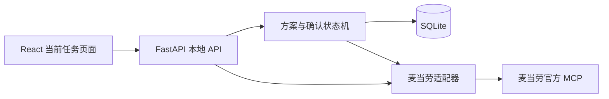

# 架构说明

当前实现以麦当劳自取交易切片验证工程边界。nanobot、语音和其他生活工具的最终产品组合尚在逐步接入，不能将规划图当作已实现能力。

## 当前模块

- `frontend/`：门店、商品与套餐选项、真实报价、确认与结果反馈。客户端价格和文字不能成为执行凭证。
- `app/main.py`：HTTP 路由、浏览器会话、本地访问边界与静态网页服务。
- `app/plans.py`：方案所有权、版本、有效期、一次性确认与持久状态。
- `app/mcd.py`：官方 MCP 连接、实时工具 schema、参数验证、业务结果检查及真实执行。
- `experiments/`：独立集成验证；不等于正式 Agent 产品代码。

运行时目标为一个 Python 服务和 SQLite；开发时有 Vite，生产页面构建后由后端提供。当前不需要独立 Redis、PostgreSQL、向量数据库或媒体服务器。

## 确认与执行

1. 服务端根据真实商品与选项核价，保存规范化请求、金额和取餐方式，生成有版本和有效期的方案。
2. 用户看到具体方案后，用明确确认操作提交该方案的版本与确认凭证；会话必须拥有该方案。
3. 后端检查状态、版本、有效期和执行开关，在数据库中原子认领执行，避免并发双击重复创建订单。
4. 执行前再次核价。金额或取餐方式不再匹配，退回重新审阅，旧确认失效。
5. 调用真实创建订单接口一次。成功后保存订单结果；异常、超时或无法确认的返回保守记为结果未知，不自动重试创建。

创建结果必须显示为「订单已创建／待支付」，不显示「已付款」或「已送达」。旧方案被新方案替换、取消或过期后，不能继续提交。

## 数据与权限

凭证保存在被忽略的本地 `.env`，不返回给浏览器。SQLite 保存本地会话和方案状态；原始账号查询结果与实验数据不提交 GitHub。默认绑定 `127.0.0.1`，浏览器会话 cookie 使用 HttpOnly／SameSite，写接口检查本地来源与主机，不能直接暴露到局域网或公网。

默认 `MCD_ORDER_ENABLED=false`。该开关只是部署执行开关，不能替代每个方案的用户确认。模型提示词、工具说明、MCP 的只读提示或事件 Hook 也不是业务授权。

已验证的 nanobot 默认 Hook 会记录并吞掉部分回调异常，因此后续 Agent 接入仍必须经过此执行层。不能同时开放未经包装的远端下单工具、任意 shell 等绕过路径。

## 失败处理与验证

区分网络连接失败、MCP 错误和业务失败；HTTP 成功不代表可下单。供应商返回夹带说明文字时，只提取明确业务 JSON，不执行文本指令。记录去凭证的诊断信息，用户界面给出可理解的失败提示。

单元测试检查确认、并发、所有权、报价变化与重启后的未知状态，使用测试专用适配器。真实只读 API 已有独立证据；真实订单创建、支付入口字段和状态查询仍需人工确认后的现场联调。

## 后续 Personal Agent

后续将个人资料、长期偏好、历史检索和工具选择接入一个统一运行时，语音识别与播报独立于交易执行。家庭地址和饮食偏好应跨会话有效，也应支持纠正、忘记与来源记录。不得仅用聊天记录仍在上下文中的成功回答，证明长期记忆已完成。
