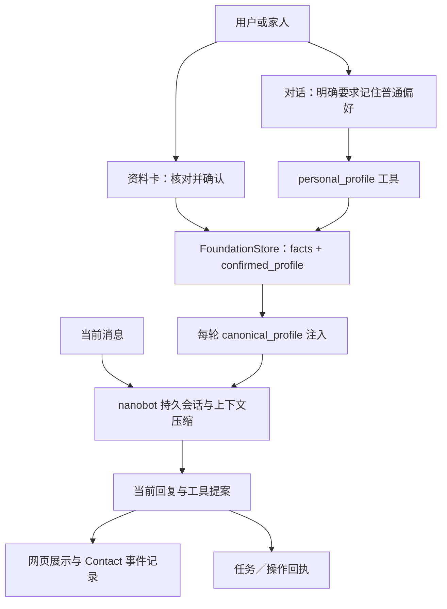

# 记忆架构：明确保存的资料可跨重启使用，长期自主记忆仍待建设

本文基于远端 `main` 的 `2216add` 核查，日期为 2026-11-05。描述的是当前实现；文中的离线测试不代表已经验证数月真人使用、模型记忆准确率或真实交易安全性。

## 现在到底有没有长期记忆？

**有可用的持久资料与持续会话，不是空壳；但还不是会自主整理人生经历、按语义检索所有往事的完整长期记忆系统。**

适合当前版本的说法是：**小瑞保存经过确认的个人资料、用户明确要求长期使用的普通偏好，以及可恢复的会话与执行记录。** 重启后这些内容仍在本机；模型每轮获得当前权威资料，历史对话由 nanobot 管理。

| 能力 | 当前判断 | 已有依据与限制 |
|---|---|---|
| 家庭住址、本人及联系人资料跨重启保存 | 已实现 | SQLite资料卡，版本校验、人工确认时间；号码格式校验不证明号码归属或地址真实 |
| 明确记住、查看、忘记普通偏好 | 已实现存储与工具通道 | `personal_profile` 的 set/list/forget；是否正确理解自然语言、选对字段仍取决于模型，需要真实对话验证 |
| 刷新／重启后恢复持续对话 | 已实现 | 浏览器owner关联本地展示记录，nanobot持久会话；清cookie或换浏览器不会自动认出同一个人 |
| 长对话上下文压缩 | 依赖运行时已有机制 | 固定版本nanobot支持摘要checkpoint和上下文预算；本项目未交付长周期准确率验收 |
| 查询过去任务结果 | 已实现记录及工具 | owner绑定执行回执，可查看成功、失败、中断、未知等；不是自动继续长期目标 |
| 自动从闲聊提炼候选、追问确认、处理矛盾 | 未实现完整流程 | 当前提示词要求明确长期意图才保存，没有独立候选队列、置信度和来源审批系统 |
| 向量库、embedding、语义RAG检索往事 | 未实现 | 当前无向量数据库或记忆搜索工具，不应把SQLite持久化称为语义检索 |
| 主动关怀、到时提醒、跨设备记忆同步 | 未实现产品闭环 | Cron生命周期不等于通知；本地单用户，无云端账号同步 |

## 四层数据分开，避免把聊天记录当成权威事实



### 1. 权威个人资料：结构化 SQLite

[`FoundationStore`](../app/foundation_store.py) 在默认 `.local-data/personal-agent/foundation.sqlite3` 建立：

| 表 | 保存什么 | 为什么单列 |
|---|---|---|
| `profile_meta` | 固定 `profile_id=local-user`、资料版本、`forget_epoch` | 支持乐观版本校验与忘记后的召回代际切换 |
| `facts` | key/value、删除标记、更新时间 | 普通偏好及资料值；删除采用墓碑标记，不从旧记录静默恢复 |
| `confirmed_profile` | 人工核对的字段、值、确认时间 | 联系方式和家庭住址只使用已核对值 |
| `sessions` | owner、conversation_id、展示记录、候选、服务状态、代际 | 保存当前会话状态，不将临时菜单和位置写成稳定偏好 |
| `tasks` | owner绑定任务输入、状态、结果、错误、时间、代际 | 提供可核查回执；重启将运行中任务标为中断，不重放 |

普通资料键为受限格式的字符串；单值上限1000字，普通 `set_fact` 通道对活跃资料设100项上限。这是一个小型键值资料库，不是无限笔记库。重要资料卡另有9个固定字段与各自长度、电话号码格式校验，见 [`profile_card.py`](../app/profile_card.py)。

**普通偏好**可以说“请记住，我更喜欢热饮”，由模型调用 `personal_profile` 才算保存成功。仅回复“记住了”不构成持久化；系统提示词明确要求真实工具调用。存储层验证格式与长度，但不会独立判断整句自然语言是否表达了长期记忆授权，因此还需检验模型的提取准确性与误保存。

**重要资料**通过“我的资料卡”填写并确认保存。宿主拒绝模型通过 `personal_profile` 修改或忘记家庭地址、姓名、电话及常见别名字段。资料卡带版本检查，旧页面不能覆盖新保存值；保存后清理旧服务候选并使待执行方案失效，保留当前聊天。旧数据中未人工核对的重要字段从 `model_profile().facts` 过滤，已确认值进入 `confirmed_fields`。

### 2. 模型会话：nanobot 保存历史，预算控制可见上下文

[`AgentService._run`](../app/agent.py) 为每轮建立nanobot运行时，使用稳定的session key：

```text
xiaorui:<owner的SHA-256前32位>:<conversation_id>:e<forget_epoch>
```

owner哈希只是键名处理，不是身份认证或数据加密。conversation_id和代际让不同会话及忘记后的后续请求进入不同的模型历史。

运行时默认位置为：

```text
.local-data/personal-agent/
├── foundation.sqlite3              # 权威资料、展示会话、任务回执
├── actions.sqlite3                 # 受控动作台账
├── contact.sqlite3                 # 收件箱、SSE事件、通话记录
└── runtime/
    ├── workspace/
    │   ├── AGENTS.md / SOUL.md      # 宿主生成的身份与策略
    │   ├── skills/                 # 项目提供的Skill文档
    │   ├── .nanobot/workspace-id    # 稳定工作区命名空间
    │   └── memory/                 # nanobot归档相关文件可能位于此处
    └── sessions/<workspace-id>/
        └── sessions.sqlite3        # 固定版本nanobot的会话与checkpoint
```

这里的nanobot会话底层是SQLite，**不是“每轮一个JSONL会话文件”**。依赖的归档层另有 `memory/history.jsonl`，用途不能与会话数据库混淆。路径中的工作区ID按初始化生成，不应硬编码。

每轮宿主向模型注入当前 `canonical_profile`、会话渠道、能力策略、服务候选、最近8项操作和当前选择。该注入是取当前结构化资料，不是对所有历史做向量相似度搜索。`data_context` 单个块限制18000字符，过长内容截断；这也不等于经过语义排序的完整召回。

`ARK_CONTEXT_WINDOW_TOKENS` 默认64000，传给nanobot作为上下文预算，需小于等于实际模型支持值；不是“保证记得64000条消息”。固定nanobot版本有历史压缩、摘要checkpoint和归档机制，以保持请求在预算内。压缩不是逐字无损保存到模型脑中，摘要可能省略或误述细节；精确地址、金额和授权仍应取结构化资料或真实业务台账。

小瑞配置关闭 `dream`、heartbeat及默认文件／Shell／Web等工具，没有开放任意记忆文件编辑或历史搜索命令。干净工作区初始化时，并未自动生成写有个人偏好的 `memory/MEMORY.md`。不能因nanobot包提供MemoryStore就宣称本产品已完成自动“梦境整理”、自主学习或全历史语义检索。

### 3. 页面历史与收件箱：恢复体验，不等于无限模型记忆

[`AgentService._answer`](../app/agent.py) 的展示快照保留最近48条用户／助手消息；[`ContactService`](../app/contact.py) 另外持久化收件箱与事件，并通过SSE恢复界面。Contact当前状态接口最多返回最近160条可恢复事件，单次增量最多256条。这些都是展示／读取边界，不代表磁盘上历史已物理删除。

电话纯转录与普通聊天在界面上分离，但底层处理记录仍可能包含通话文本。用户看不到一句话，不等于它没有被保存；界面恢复、模型上下文和审计留存应分别理解。

### 4. 任务与交易台账：保存事实，不自动再做一次

`tasks`记录每轮输入和执行结果；`actions.sqlite3`及旧方案库保存确认、金额、外部执行状态。服务重启不会自动重放未知交易，不能把“有记忆”解释成自动完成昨天没做完的订单。

这些台账支持“刚才查到了什么”“是否已提交”等可核查问题，但没有长期目标分解、自动续办或主动提醒用户的完整产品接口。

## “忘记”具体做了什么？

普通偏好的 `forget` 实现了以下链路：

1. `facts`将对应值置空并标记删除，移除对应确认值。
2. 增加资料版本及全局 `forget_epoch`，清除FoundationStore展示会话。
3. 当前宿主切换conversation_id和代际，清理候选并使当前owner的旧待确认动作失效。
4. **后续模型请求**使用新的session key；任务查询对旧代际输入与结果做遮蔽。

这是召回隔离机制，**不是全盘安全擦除接口**。旧nanobot会话、Contact收件箱／事件、任务原始记录、订单台账、备份以及云端服务留存不会因此全部物理删除；当前轮次已经加载的上下文也不能被逆向抹除。不能对外承诺“忘记后任何地方都没有这条信息”。

重要资料不能经聊天forget；通过资料卡清空并明确确认。资料卡更新保留当前对话，不会轮换forget代际，因此它也不是历史清理功能。项目尚未提供统一的数据导出、保留期限与全链路删除管理。

## 能不能真实用：建议按用途验收

**可以用于本机单用户的明确资料和偏好保存。** SQLite重启恢复、资料卡确认、旧版本冲突、忘记后隔离和任务owner边界都有离线覆盖。它比只把所有历史塞回提示词更可核查，也能将短期候选和稳定资料分开。

**不能据此承诺长期陪伴记忆已经成熟。** 当前缺少长期自然对话中的召回质量评估、事实来源与置信度、矛盾解决、自动候选确认、过期策略、完整删除和多用户身份体系。家庭资料有人工确认，不代表用户所有聊天事实都已验证。

| 使用目的 | 推荐做法 |
|---|---|
| 记住饮品或交流偏好 | 明确要求保存，再查看资料；改口后核对最终值 |
| 使用家庭地址、联系人 | 本人或家人在资料卡核对；不依赖旧聊天或模型补全 |
| 回忆上一次工具结果 | 查看当前任务与真实来源；失效价格、位置和报价重新查询 |
| 回忆几个月前所有经历 | 暂不承诺；需专门的长期数据集、检索与准确率验证 |
| 提醒、长期目标自主推进 | 当前转手机闹钟／官方应用；不能只因持久化就承诺主动触达 |

## 隐私与隔离边界

当前 `profile_id` 固定为 `local-user`，**个人资料跨同机浏览器owner共享**。会话、任务和动作按owner隔离，资料本身不是每个owner一份。`pa_session` cookie用于归属与恢复，不是登录认证；不要把当前应用部署成公网多用户记忆服务。

`.env`与`.local-data/`被Git忽略；默认数据目录700、相关数据库600。但SQLite内容未做应用级加密，数据库、运行时历史和备份都应视为敏感数据。默认本机监听与Host／Origin检查不能替代远程身份认证。

“本地记忆”也不等于“离线推理”：每轮选入的资料与对话会被发送给模型服务；语音、地点、地址与订单查询分别发送给完成任务所需的提供方。备份前停服务，使用私有／加密位置，不把数据库、截图或录音提交到公开Issue或PR。

## 如何复现已有保证

在仓库根目录、安装锁定依赖后运行：

```sh
uv run python -m unittest discover -s tests -p 'test_foundation_store.py' -v
uv run python -m unittest discover -s tests -p 'test_profile_card.py' -v
uv run python -m unittest discover -s tests -p 'test_agent.py' -v
```

本轮在Linux使用临时测试数据实际运行上述三个测试文件，**33项通过**；没有调用真实模型或商家接口。它们覆盖资料与会话重启、资料卡版本与确认、关键字段工具禁改、忘记代际、任务恢复和owner隔离等，不等于33项全是记忆质量测试。

另以假凭据、临时目录初始化真实锁定nanobot运行时，核实SQLite会话路径、默认64000上下文预算和干净工作区未创建个人MEMORY.md；未发起网络推理。因此“模型能在长周期正确回忆”仍需单独验收。

建议真人验收至少覆盖：保存后重启读取；显式改偏好；忘记后另轮追问；资料卡与旧聊天冲突；换浏览器／清cookie；长期对话超预算后检查关键事实；备份恢复后的会话关联。记录实际模型、样本、成功与失败，不只让模型自评“我记得”。

## 实现入口

| 文件 | 维护者应读的内容 |
|---|---|
| [`app/foundation_store.py`](../app/foundation_store.py) | 表结构、资料版本、确认字段、会话快照、忘记与任务回执 |
| [`app/profile_card.py`](../app/profile_card.py) | 固定重要字段、别名保护、输入校验 |
| [`app/agent.py`](../app/agent.py) | 工具分派、每轮上下文、会话key、历史与任务遮蔽 |
| [`app/nanobot_runtime.py`](../app/nanobot_runtime.py) | 固定运行时配置、工具白名单、dream关闭、数据块边界 |
| [`app/contact.py`](../app/contact.py) | 持久消息／通话与SSE恢复 |
| [`app/main.py`](../app/main.py) | 资料卡API、cookie归属与本机来源边界 |
| [`tests/test_foundation_store.py`](../tests/test_foundation_store.py)、[`tests/test_profile_card.py`](../tests/test_profile_card.py)、[`tests/test_agent.py`](../tests/test_agent.py) | 可复现离线保证 |

依赖实现以 [`pyproject.toml`](../pyproject.toml) 和 [`uv.lock`](../uv.lock) 锁定的 `nanobot-ai==0.4.0` 为准；包内的 `nanobot/session/{manager,location,sqlite_store}.py`、`nanobot/agent/{context,memory,loop}.py` 负责底层会话、摘要与归档。升级依赖后应重查路径与行为，不能照搬本文实现细节。
