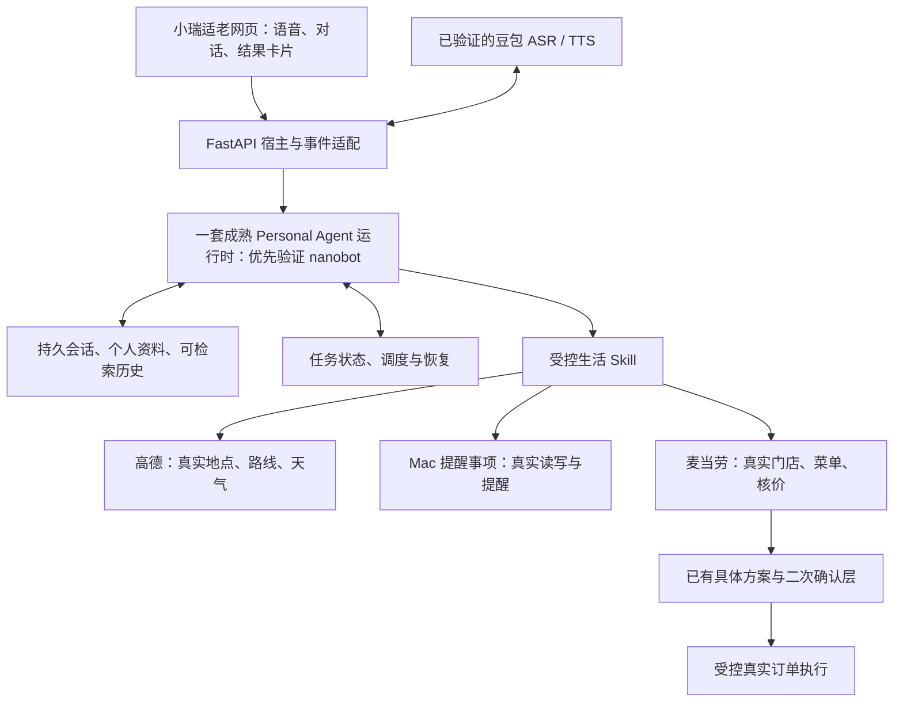

# 小瑞 Personal Agent 底座复查与范围纠正

调研日期：2026-11-04。范围：官方 GitHub 源码、官方产品文档及当前项目代码；本轮不替换运行时、不启动新平台、不改变真实账号资料。

## 结论

原始题目明确要求本地部署、真实外部 API、一键运行和设计交付，没有提供评分量表，也没有明确要求特定记忆架构或框架。因此不能断言接两个 MCP 一定不合格，也不能保证当前点餐演示足以通过面试。

结合用户的产品定位，当前作品应归类为「可语音交互的麦当劳任务切片」。它证明了真实接口、交互和交易确认能力，但还没有完整展示持续服务同一个人的能力。继续增加几个点餐工具，不能解决个人记忆、跨场景协作、持续任务与恢复这些缺口。

建议采用成熟 Personal Agent 运行时，保留小瑞的语音、适老网页和业务确认层。**第一候选为 nanobot 的受控嵌入；Hermes 为备选；OpenClaw 与 QwenPaw 为完整产品参照及可独立部署的备选。** 选择理由是现有 Python 工程和已完成的真实兼容验证，而非认为其他候选不具备个人助手能力。

## 当前实现与缺口

- `app/agent.py` 的工具只有搜索门店、推荐套餐、选择套餐、取消方案四类，均围绕麦当劳。
- 同文件中的 system prompt 明确声明不支持出行、提醒和长期记忆。
- `Session` 保存的是有界进程内上下文；网页刷新恢复不等于服务重启后仍记得用户。
- SQLite 已保存交易方案与确认状态，但没有通用的任务、个人资料与提醒管理。
- 豆包实时识别、真实 TTS、多轮工具调用、真实 MCP 卡片和二次确认可以复用。

此前 `docs/personal-agent-research.md` 已建议验证完整运行时，且 `docs/nanobot-validation.md` 已记录真实模型与跨进程偏好读写。后来网页为优先跑通点餐而采用自建工具循环；底座建议没有真正接入产品，这是本轮需要纠正的工程方向。

## 候选比较

以下功能来自官方文档和源码声明，不等于本项目逐项验收通过。默认分支快照不是稳定版安装承诺。

| 项目 | 实际个人助手能力 | 对小瑞的复用路径 | 成本与限制 | 判断 |
| --- | --- | --- | --- | --- |
| [nanobot](https://github.com/HKUDS/nanobot) | Python 运行时、持久会话、用户／长期记忆、Skill、MCP、cron，SDK 可流式返回事件 | 嵌入 Python 后端，替换自建 `AgentService` 的模型循环，复用会话与记忆；自有适老前端继续保留 | SDK 单独实例不会自动启动 Gateway 的 Dream 调度；先前自定义工具实验用了私有访问，正式接入要做受控组合；默认依赖并不只有几个 | 最优先验证的工程底座 |
| [Hermes Agent](https://github.com/NousResearch/hermes-agent) | 用户画像、持久记忆、历史检索、经验 Skill、定时自动化 | 使用其运行时或 Web Dashboard 插件，接入小瑞语音及交易确认服务 | 当前安装链较复杂；Web Dashboard 与原生 Desktop 的插件 SDK 不同；本轮未安装或验收 | 第二候选；特别适合参考持续记忆与任务体系 |
| [OpenClaw](https://github.com/openclaw/openclaw) | 本地 Gateway、个人工作区、会话／记忆、Skill 与插件、自动化、多入口 | 独立运行 Gateway，小瑞通过官方 HTTP API 接入，并以插件开放生活能力 | 引入 Node 运行时；普通聊天 HTTP 接口不能直接推定能承载所有卡片与业务确认；需验证插件事件桥接 | 完整个人助手的重要产品参照，可作运行时备选 |
| [QwenPaw（CoPaw 当前官方仓库）](https://github.com/agentscope-ai/QwenPaw) | 本地个人助手产品，ReMe 记忆、Skill／插件、MCP、定时任务、管理控制台 | 运行官方服务，通过扩展或接口接小瑞界面，参考其记忆与任务管理 | Python 主依赖包含 AgentScope、ReMe、Playwright、Transformers、ONNX Runtime、pywebview 等；不能视为最少依赖路线；正式改造路径需实验 | 产品相关性高，依赖约束下不先直接整体迁移 |

许可证：nanobot、Hermes、OpenClaw 为 MIT；本次 QwenPaw 快照为 Apache-2.0。采用或复制代码需保留对应许可与版权。

### 这次查到的版本变化

- 官方 `agentscope-ai/CoPaw` 地址现重定向到 `agentscope-ai/QwenPaw`。不要按未核实的旧 CoPaw 教程部署。
- [Letta 旧仓库当前 README](https://github.com/letta-ai/letta) 指向 `letta-ai/letta-code` 作为当前源码；`archive` 分支是已退役的 V1 API 服务。其记忆思想仍值得参考，但不把旧 Python 服务方案当作当前默认路线。
- nanobot 文档明确区分持久会话、长期记忆与 Dream；压缩历史不等于用户资料已经整理完成。
- Hermes 记忆文档说明 `USER.md` 和 `MEMORY.md` 持久化，系统提示使用会话起始快照；本轮修改后的即时反馈应以工具实时结果为准，不能假设 prompt 中途自动更新。

## 哪些已经实测，哪些只是候选

1. **nanobot 已有本地证据**：项目内隔离环境安装过 `nanobot-ai==0.4.0`，真实豆包 Chat Completions 工具调用及新进程读取测试偏好通过。此前安装快照为 108 个发行包，不能用当前项目的轻量锁文件替代这项成本。
2. **仍未通过完整底座验收**：受控工具组合、完整 Gateway 调度接入、小瑞卡片事件桥接、用户资料纠错与忘记、执行中的任务恢复。
3. **其他候选本轮是源码／文档调研**：没有新安装 Hermes、OpenClaw 或 QwenPaw，更没有证明哪个能开箱即用支持豆包流式语音和我们的交易确认。
4. 正式实施固定经验证的发布版本／提交，不追着默认分支升级。快照 SHA 与许可证保存在 `docs/research/2026-11-04/personal-agent-reassessment/`。

## 作品需要展示的完整能力

这里的目标是一个能力边界明确、能持续服务同一个人的助手：

1. **个人资料**：家在哪里、常用地点、预算和饮食偏好能够保存；新聊天和重启后仍可用，能查看、纠正与忘记。一次性要求与长期偏好分开。
2. **通用任务执行**：同一助手理解不同生活需求，选择工具、追问缺失信息、说明真实进度；业务能力按 Skill 接入，而不是在首页做几个固定按钮。
3. **跨场景协作**：用同一份家庭地址和偏好完成出行、提醒、用餐。麦当劳只是用餐 Skill 的一个真实服务提供者。
4. **持续任务**：记录任务的待补充、执行中、等待确认、已完成、失败、结果未知状态；新聊天可以查询、修改或取消。重启后恢复可核实的任务；未知写入结果不能盲重试。
5. **适老交互**：同一语音入口，少追问、短句播报、明确金额与地点、真实结果卡片；失败后给出下一步操作。
6. **可核实执行**：购物、支付等真实写操作由服务端绑定具体方案再次确认。通用运行时的 shell、HTTP 或原始 MCP 工具也不能绕开同一执行边界。

不要求为展示完整性就同时上多 Agent、复杂向量库或多服务集群。关键是上述行为跨场景成立，并有复现证据。

## 建议架构与迁移方式

- 保留前端、豆包语音、`McdService`、确认 SQLite 与测试。
- 将当前 `app/agent.py` 降为运行时适配层，不继续在其中手写完整记忆与调度平台。
- 复用运行时的会话、上下文、Skill 与调度；家庭地址等关键资料使用可审阅的确定性写入，不依赖后台整理碰运气。
- 个人身份不能只依赖可丢失的浏览器 cookie。Mac 单用户先绑定本地个人工作区，聊天 session 与个人 profile 分离。
- 日常页面保持简洁；资料与任务用自然语言进入，必要时展示小型卡片，不回到复杂后台式首页。
- Mac 主机睡眠或服务退出时，Python 后台定时器不能保证提醒送达。提醒交付优先验证苹果提醒事项的真实系统能力，明确权限与可用条件。

## 下一阶段的验证顺序

### 先做底座整合验证

优先用已安装的 nanobot 隔离实例验证四项：真实豆包工具调用、受控工具注册、跨进程个人资料、结构化事件转为现有卡片。确认调度运行方式与进程生命周期。禁止以“安装成功”替代集成成功。

若受控工具必须靠大量私有 API 或默认工具无法可靠限制，则切换 Hermes 插件／独立服务路径评估；不在多个平台间反复重写前端。

### 再接两个不同生活领域

- 高德：实际位置查询、地理编码、路线和天气。打车唤端只交接给官方 App，不能说成已叫到车。
- 苹果提醒事项：真实创建、查询、修改和取消。先验证 Mac 权限与系统 API，不因本地运行就当作无须授权。

原始要求中的外部 API 真实性以实际调用记录验收；用户扩展理解中提到的地图能力在实现前保持待办。

### 最后演示同一个人的一天

首次保存家庭地址与常用地点 → 新聊天用“回家”规划路线 → 为明天到某地点创建提醒 → 查询路线和天气 → 依据已保存预算推荐午餐 → 中途改需求并恢复任务 → 修改／忘记一条个人资料。

每一步只声称已真实完成的部分，位置不明就追问；路线规划、打车、订单创建和支付分别展示实际状态。

## 建议验收用例

| 验收 | 必须观察到的结果 |
| --- | --- |
| 记住家并重启 | 不重复提供地址，说“回家”后读取持久资料，而不是依赖旧聊天上下文 |
| 偏好跨场景 | “以后饮料不要冰”影响后续相关任务；“今天预算20”不自动变成永久默认 |
| 三类真实能力 | 相同对话入口完成地图查询、系统提醒事项、餐品查询；接口失败明确显示 |
| 中断与恢复 | 等待确认的任务重启后仍可查；查询失败可重试，未知交易结果不可重复执行 |
| 纠错与忘记 | 修改后使用新资料；删除后旧摘要／检索不能悄悄恢复该事实 |
| 写入确认 | 改金额／商品／地址使旧确认失效，模型不能通过另一条工具路径下单 |
| 交付复现 | GitHub 干净下载、填写凭据、一键启动；README 分清已完成、权限要求与不支持能力 |

## 官方参考

- [nanobot Python SDK](https://github.com/HKUDS/nanobot/blob/main/docs/python-sdk.md)、[记忆](https://github.com/HKUDS/nanobot/blob/main/docs/memory.md)、[依赖](https://github.com/HKUDS/nanobot/blob/main/pyproject.toml)
- [Hermes 个人记忆](https://hermes-agent.nousresearch.com/docs/user-guide/features/memory)、[调度](https://hermes-agent.nousresearch.com/docs/user-guide/features/cron)、[Dashboard 扩展源码文档](https://github.com/NousResearch/hermes-agent/blob/main/website/docs/user-guide/features/extending-the-dashboard.md)
- [OpenClaw HTTP Gateway](https://docs.openclaw.ai/gateway/openai-http-api)、[记忆](https://docs.openclaw.ai/concepts/memory)
- [QwenPaw README](https://github.com/agentscope-ai/QwenPaw)、[依赖](https://github.com/agentscope-ai/QwenPaw/blob/main/pyproject.toml)
- [Letta 当前入口说明](https://github.com/letta-ai/letta)

本轮报告是选型与范围建议，没有把尚未实现的能力写成已交付。后续工作量仍受外部接口权限和受控运行时整合结果影响。
